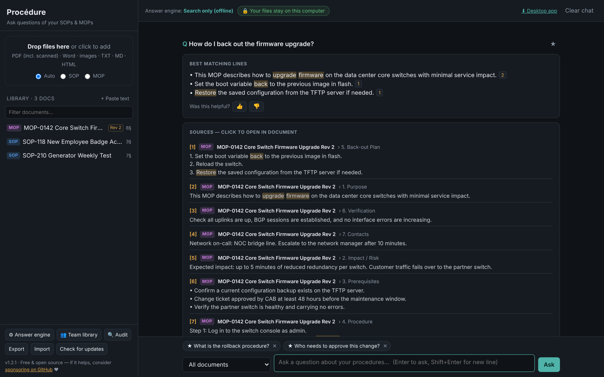
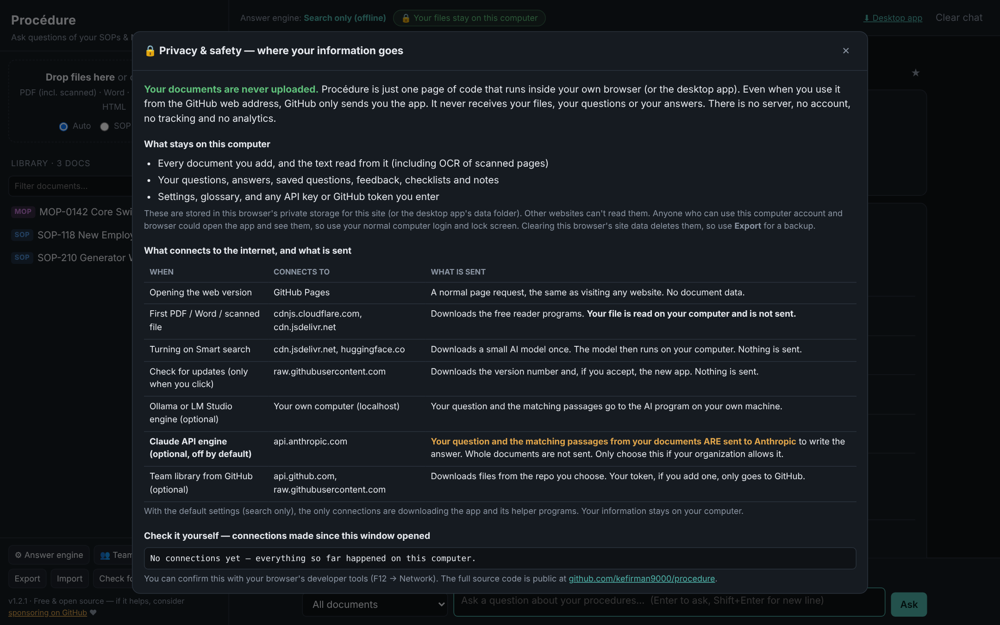
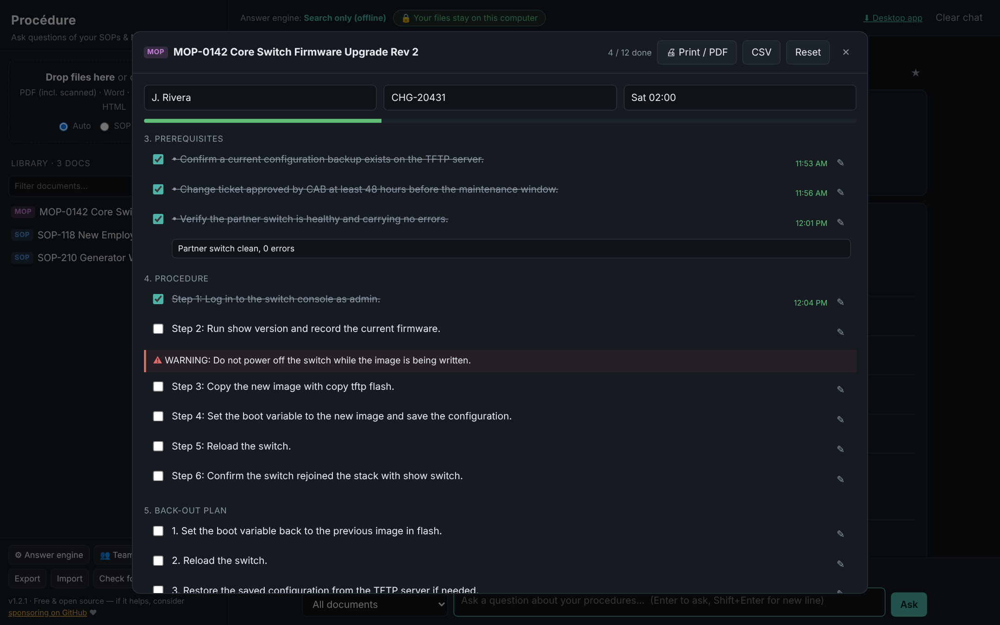
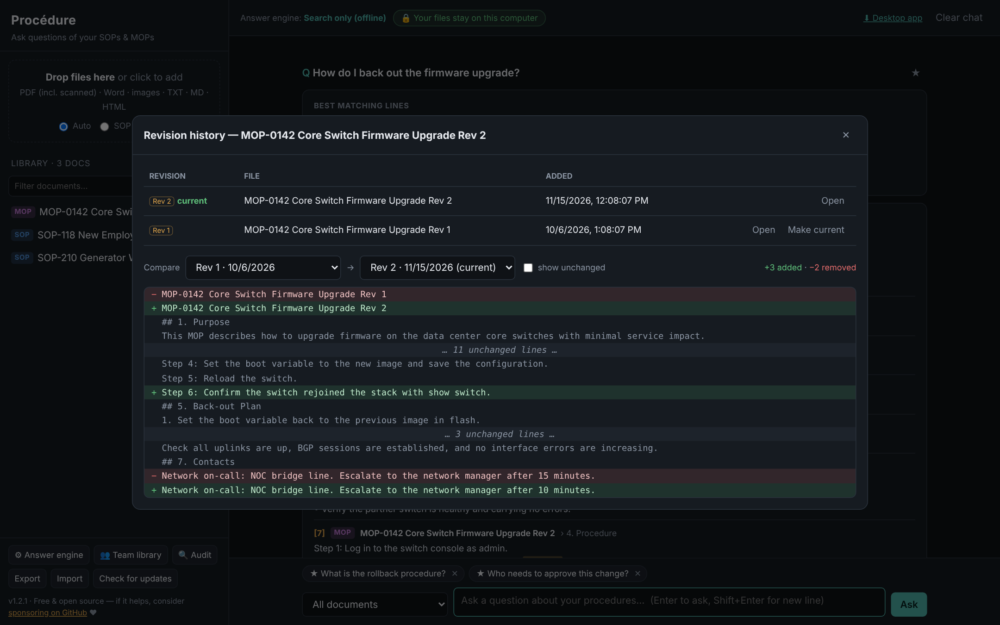
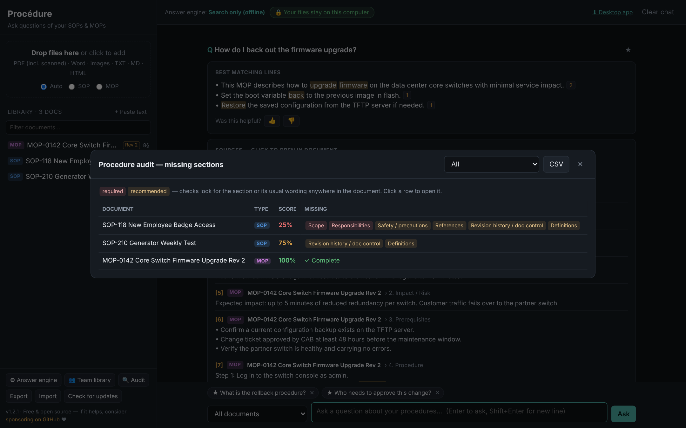

# Procédure

Ask questions of your **SOPs** (Standard Operating Procedures) and **MOPs** (Methods of Procedure) and get answers from your own documents, with links to the exact section each answer came from.

**Use it on the web:** https://kefirman9000.github.io/Procedure/
**Windows desktop app:** [latest release](https://github.com/kefirman9000/Procedure/releases/latest) (installer or portable .exe)

## Screenshots
**Ask a question:** answers point to the exact section of the procedure

**Privacy panel:** see what stays on your computer and every connection the app makes

**Checklist mode:** tick off a MOP during the maintenance window, with times and notes

**Revision history:** compare any two versions of a procedure

**Audit:** find procedures missing rollback, verification, approvals and other sections

*Screenshots use made-up sample procedures.*

## 🔒 Privacy & safety — your information isn't going anywhere
**Your documents are never uploaded, including when you use the GitHub web version.** Procédure is a single page of code that runs entirely inside your own browser (or the desktop app). GitHub Pages only delivers the app to you. It never receives your files, questions or answers. There is no server, no account, no tracking and no analytics.

- **Stored only on your computer:** your documents and their text, questions, answers, checklists, notes, settings, and any key or token. They are kept in your browser's private storage for this site (or the desktop app's data folder), where other websites can't read them.
- **Internet is used only to download things:** the app itself, the free PDF/Word/OCR reader programs, and the smart-search model, the first time you need each one. Your files are read on your computer and are not sent with these downloads.
- **Local AI stays local:** Ollama and LM Studio run on your own machine.
- **The one exception, off by default:** if you choose the **Claude API** engine, each question and the matching passages (not whole documents) are sent to Anthropic to write the answer. The app asks you to confirm before turning it on, and shows a warning badge while it's on.
- **Check it yourself:** the 🔒 panel in the app lists every connection made since the window opened. You can also watch F12 → Network, and all the source code is in this repo.
- **Voice questions** (optional, asks first) use your browser's speech service, which is Google in Chrome and Microsoft in Edge, so the sound of your question goes there. Read-aloud uses voices on your computer.
- **PIN lock:** turn it on and your documents, original files, checklist notes and API keys are encrypted on your computer. A forgotten PIN can't be recovered.
- **Delete everything:** the 🔒 panel has a button that removes all Procédure data from your computer.

Anyone who can use your computer account can open the app and see your library, the same as any other file on your PC, so keep your normal login and lock screen.

## Features
- **Add any procedure file:** PDF, Word (.docx), TXT, Markdown, HTML, CSV, or pasted text. Scanned PDFs and photos are read with built-in text recognition (OCR).
- **Ask questions** across everything, SOPs only, MOPs only, one document, or old revisions too.
- **Answers you can check:** every answer links to its source section. In search-only mode it works fully offline.
- **Optional AI answers:** Ollama (local), LM Studio or any OpenAI-compatible server, or the Claude API with your own key.
- **Smart search:** an optional small local model matches by meaning, so "rollback" finds "back-out plan". Common procedure synonyms are built in.
- **Glossary:** add your team's abbreviations (`MW = maintenance window`) and questions in either form will match.
- **Checklist mode:** run any SOP or MOP as a tick-off checklist. Each step is timestamped and can take a note, warnings are highlighted, and you can enter operator, ticket and window details. Print it or save it as a PDF or CSV.
- **Revision tracking:** add a newer version of a file and the old one goes into History. You can compare any two revisions line by line or restore an old one.
- **Audit:** finds MOPs missing rollback, verification, approvals, impact or pre-checks, and SOPs missing purpose, scope, responsibilities and similar sections. You can export the report as CSV.
- **Team library:** sync a shared folder (network drive, OneDrive or SharePoint sync) or a GitHub repo. Changed files come in as new revisions, and removed files drop out.
- **Saved questions:** pin the questions you ask often for one-click answers.
- **Answer feedback:** 👍/👎 an answer and its sources rank higher or lower for similar questions.
- **Export and import** your library to back it up or move it between PCs.
- **In-app updater:** it checks GitHub and only updates if you say yes.
- **View the original:** open the real PDF page (or image) behind any answer, with the matching lines highlighted.
- **Tables understood:** rows in PDF, Word, Markdown and CSV tables are read with their column names, so "what's the IP of core-sw2?" finds the right row.
- **Voice:** ask by voice 🎤 (it asks first, and uses your browser's speech service), and have answers or checklist steps read aloud 🔊 with voices on your computer, hands-free.
- **Phone checklists:** scan a QR code to run a checklist on your phone at the rack or in the plant room. The steps travel inside the link, so nothing is uploaded.
- **Review dates:** reads "effective", "revised" and "next review" dates and flags procedures that are overdue for review.
- **Outdated terms:** list old firmware versions, retired hostnames or people who've left, and the audit flags every procedure that still mentions them.
- **Draft from notes ✍:** turn notes from a past change into a draft MOP or SOP with all the usual sections. It uses a built-in template, or AI if you've turned an engine on.
- **Compare ⇆:** see two procedures side by side by section, line by line, or as an AI summary.
- **Quiz 🎓:** training questions made from any procedure, with a link back to the right section.
- **Share answers:** copy an answer with its sources to paste into a ticket or email, or print it.
- **PIN lock 🔐:** optionally encrypt everything on the computer (AES-256), with auto-lock when idle.
- **Multiple libraries:** keep separate sets like Network, Facilities and Security, each with its own team sync.

## Run it
- **Web:** open the link above in Edge or Chrome.
- **Local file:** download `index.html` and double-click it.
- **Desktop app:** download the setup or portable `.exe` from Releases. Your library lives in the app's own data folder, which you can open with the **Data folder** button.

PDF, Word, OCR and smart search download their helper libraries the first time you use them, so that step needs internet. After that, search runs on your computer.

## Local AI with Ollama (easy setup)
If you want AI-written answers that stay on your computer:
1. In the app, open **⚙ Answer engine** and click **Install local AI**. You can leave the model on "pick the best model for my PC".
2. **Desktop app:** a setup window opens. **Web version:** a small `Setup-Local-AI.cmd` file downloads. Open it, and if Windows shows "Windows protected your PC", click *More info → Run anyway*.
3. The setup installs [Ollama](https://ollama.com) (free), allows **only Procédure** to talk to it, and downloads a model sized to your PC's memory (1–5 GB). Procédure detects it and switches over by itself.

You can read the setup script before running it: [`setup/Setup-Local-AI.cmd`](setup/Setup-Local-AI.cmd). On Mac or Linux, install Ollama from ollama.com, run `ollama pull llama3.2`, then click **Detect & connect**.

## Releasing an update
Bump `VERSION` in `index.html` and `version` in `version.json`, then push to `main`. The web version updates automatically, and the Windows `.exe` files are built and published as a release automatically.

## Support
Procédure is free and open source. If it saves you time, please consider [sponsoring me on GitHub](https://github.com/sponsors/kefirman9000) ♥
